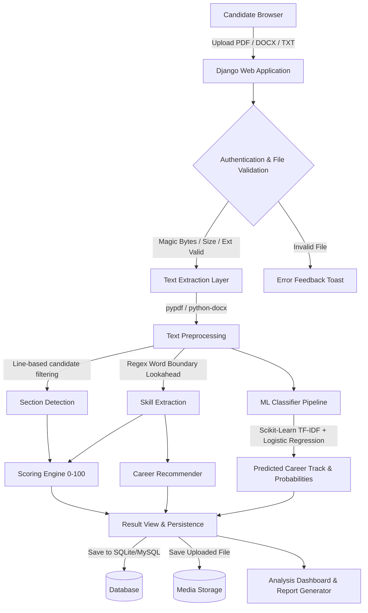

# System Architecture & Technical Workflow

## 1. High-Level Architectural Flowchart

---

## 2. Layered Architecture

### Layer 1: Presentation & User Experience (Frontend)
- **HTML5 & Vanilla CSS3**: Custom dark navy color scheme (`#0B0F19` base, glassmorphism cards with `backdrop-filter: blur(12px)`).
- **Bootstrap 5 CDN**: Responsive grid, modal dialogs, responsive navigation bar, and Bootstrap Icons.
- **Micro-Interactions**: Real-time drag-and-drop resume upload zone, score ring SVG rendering, auto-dismissing feedback alerts, and interactive score delta revision comparison.

### Layer 2: Web Routing & Access Control (Django Controllers)
- **Settings & Security (`AI/settings.py`)**: Environment-based `SECRET_KEY`, CSRF protection, secure cookie flags, and session management.
- **Controllers (`resumeapp/views.py`)**:
  - `upload_resume`: Coordinates upload validation, text parsing, scoring, ML inference, and DB persistence.
  - `result_detail`: Visualizes score breakdown, extracted skills, career recommendations, and ML probability meters.
  - `download_analysis_report`: Generates a downloadable text file report with user authorization check.
  - `download_original_resume`: Secure `FileResponse` view serving user files only to authenticated owners.
  - `compare_resumes`: Side-by-side comparison of 2 resume revisions calculating score differences, newly added skills, and omitted skills.
  - `history`: Server-side search (`q`), sorting (`score_high`, `score_low`, `newest`, `oldest`), and pagination.

### Layer 3: Natural Language Processing & Document Services
- **Document Extractors (`services/text_extractor.py`)**:
  - `extract_text_from_pdf`: Uses `pypdf.PdfReader` with OCR fallback warning for scanned PDFs.
  - `extract_text_from_docx`: Uses `python-docx` iterating through document paragraphs and table cells.
  - `extract_text_from_txt`: Decodes plain text using UTF-8 with Latin-1 fallbacks.
- **Preprocessor & Section Detector (`services/text_preprocessor.py`)**:
  - `detect_sections`: Analyzes text line-by-line matching short standalone headings (<= 5 words, <= 60 characters) against known resume sections (*Contact, Summary, Experience, Education, Skills, Projects, Certifications*). Eliminates false positives from words appearing in body sentences.
- **Skill Extractor (`services/skill_extractor.py`)**:
  - Evaluates text using boundary lookaheads `(?![a-zA-Z0-9#+])` and conjunction-aware regex patterns to extract languages like `C++`, `C#`, `C`, `Go`, `R`, `Machine Learning`, `Deep Learning`, `Python`, `Java`, and `JavaScript` without false positives.
- **Scoring Engine (`services/resume_scorer.py`)**:
  - Transparent 0–100 score: Section Structure (30 pts), Skill Richness (35 pts), Document Length (15 pts), and Job Alignment (20 pts).

### Layer 4: Machine Learning Inference Pipeline
- **Inference Service (`ml/classifier.py`)**:
  - Loads trained Scikit-Learn pipeline (`ml/models/resume_classifier.joblib`).
  - Generates top predicted career category and full probability distribution across categories: *Python Developer, Web Developer, Data Scientist, Backend Developer, Machine Learning Engineer*.
- **Training & Evaluation (`ml/model_training.py`, `ml/model_evaluation.py`)**:
  - Uses `datasets/resume_dataset.csv`.
  - Performs stratified train/test split (75% train / 25% test, `random_state=42`).
  - Featurizes text using `TfidfVectorizer(max_features=500, stop_words='english')` fitted exclusively on training set to prevent data leakage.
  - Evaluates model exclusively on held-out test data.

### Layer 5: Data Persistence & Storage
- **Django ORM Models**: `UserProfile` and `ResumeAnalysis` stored in SQLite or MySQL.
- **Private Media Storage**: Resumes stored under `media/resumes/%Y/%m/` and accessed through authenticated view wrappers.
